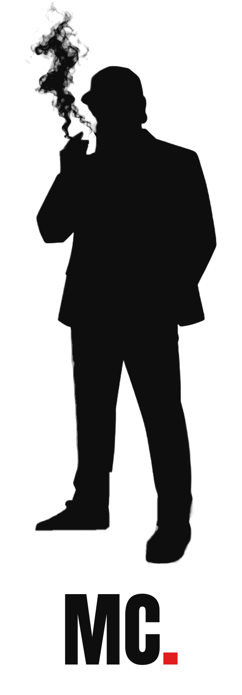
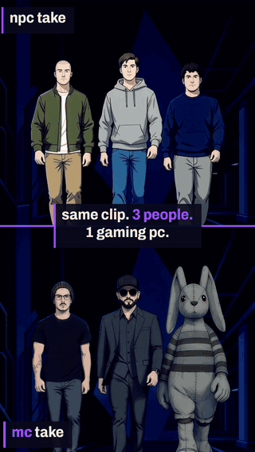
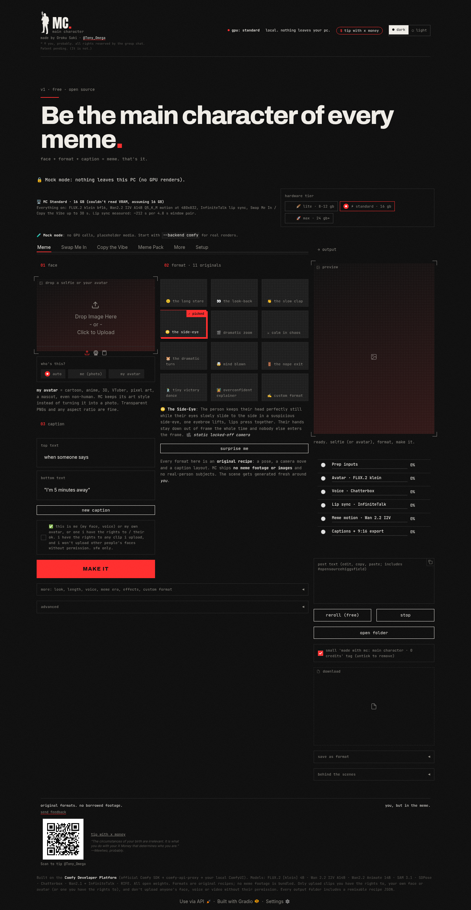
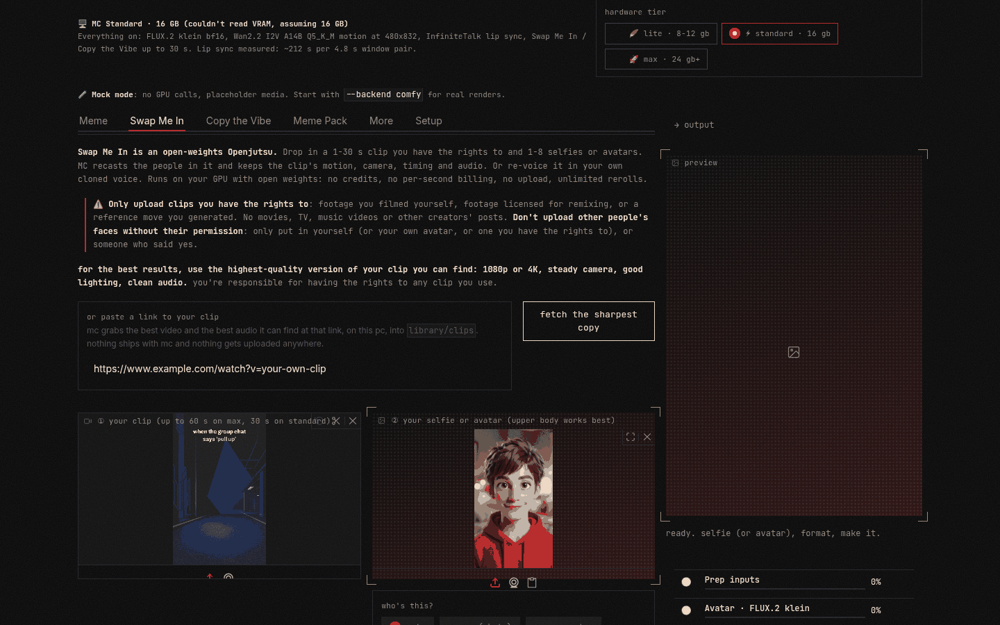
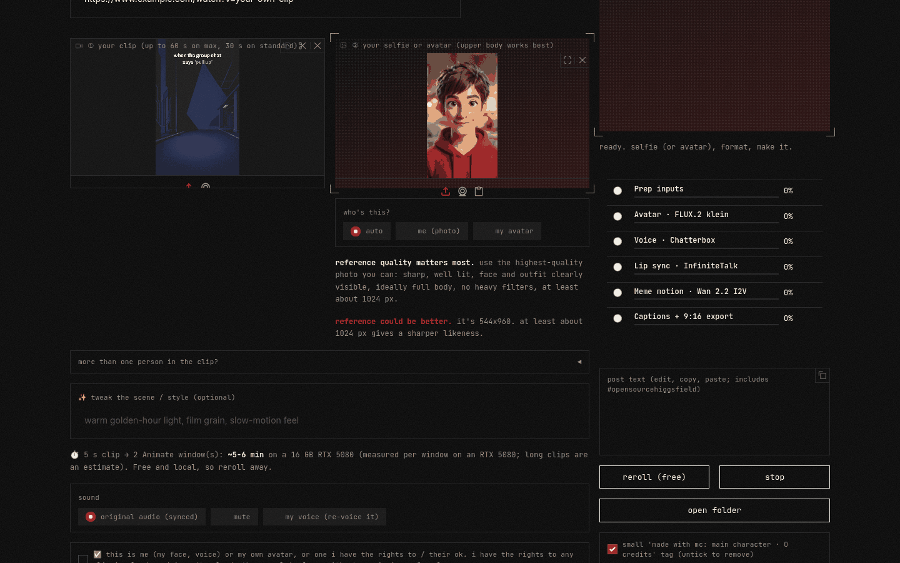
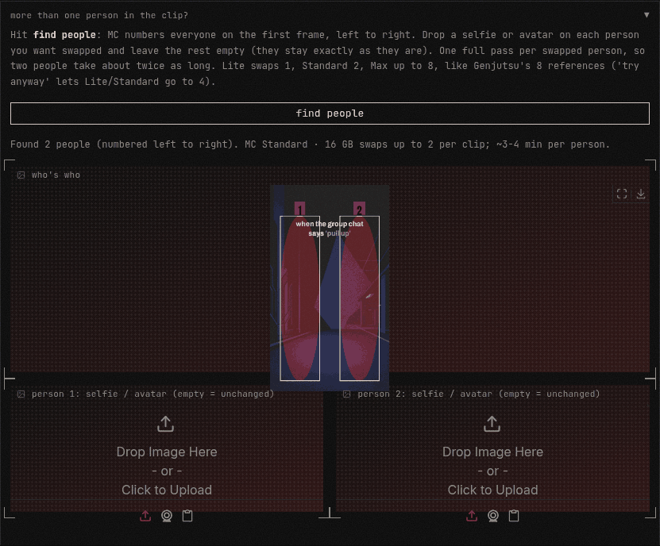
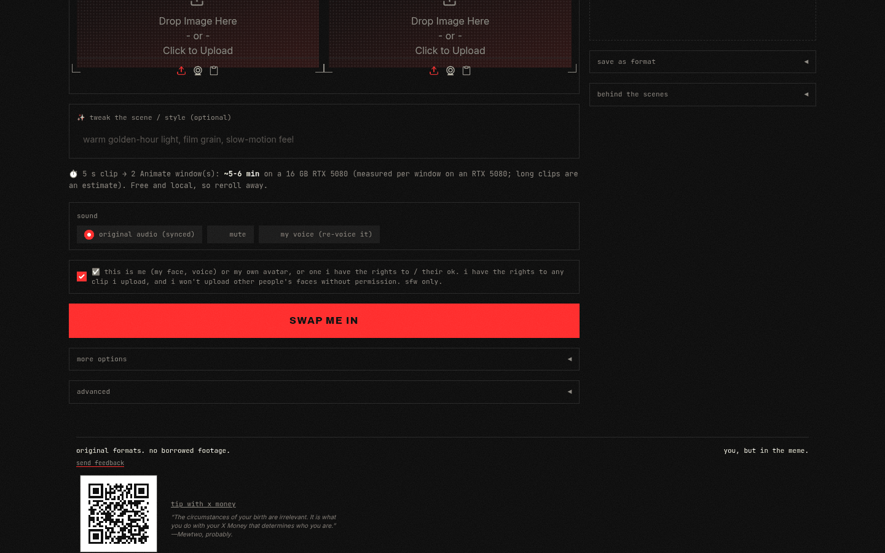
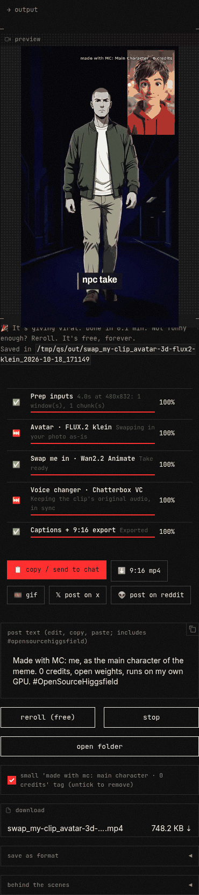
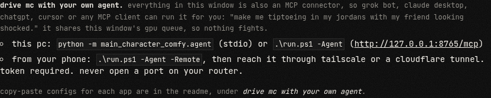
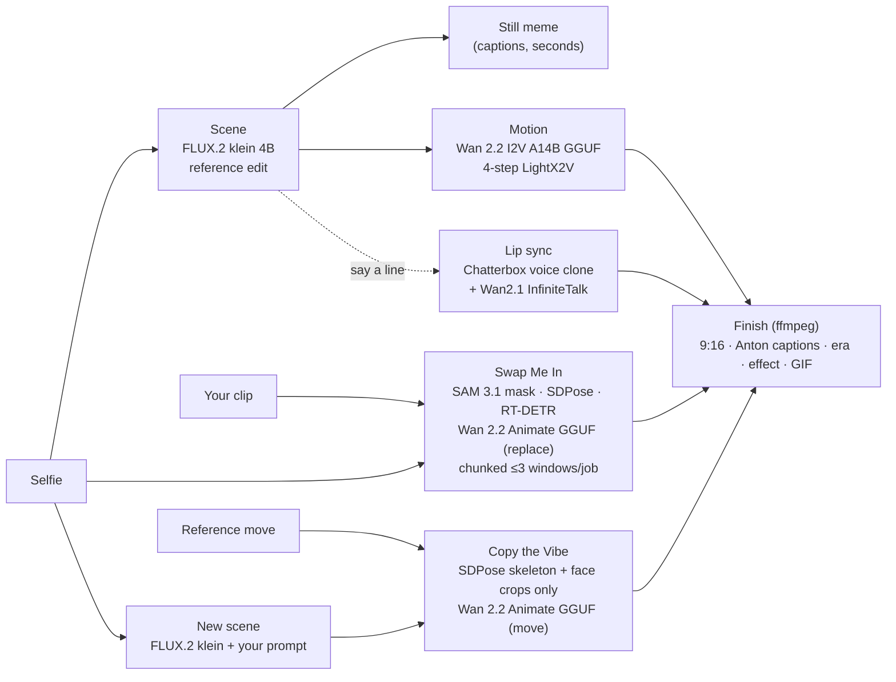

# MC = Main Character (`main-character-comfy`)

<p align="center">
  <picture>
    <source media="(prefers-color-scheme: dark)" srcset="main_character_comfy/assets/brand/mc_logo_dark.png">
    
  </picture>
</p>

<p align="center"><sub>The logo is a silhouette of the author, Oroku Saki (<a href="https://x.com/Tony_Omega" target="_blank" rel="noopener">@Tony_Omega</a>): his own likeness, used with his consent. No one else's face or likeness is in it.</sub></p>

## Demo: PULL UP (45 s)

<p align="center">
  <a href="docs/demo/MC_demo_pullup_9x16.mp4"></a>
</p>

<p align="center"><b><a href="docs/demo/MC_demo_pullup_9x16.mp4">▶ Watch the full 45 s demo (9:16, with sound)</a></b></p>

One generated clip of three people walking up, recast in a **single SCAIL-2 pass** with one reference image per person, then sharpened to 1080p with SeedVR2. It was rendered on one RTX 5080 with open weights only. The walkers, corridor and music (ACE-Step) are generated, the UI shots are a screen capture of MC itself, and the spoken line is the author's own recording, lip-synced with InfiniteTalk (MC's talk mode, voice set to **I'll record it myself**; CLI `--recording`). The three characters are stylized avatars supplied and approved by the author.

Reference images were supplied by the users; some were made with Grok Imagine, a closed model, outside MC. MC itself runs only open weights models.

**Be the main character of your memes.** MC is a free, local, open-weights app that puts **your face or your avatar, and your own cloned voice,** into meme formats. Its **Swap Me In** mode is an **open-weights Openjutsu**: an open rebuild of Higgsfield Genjutsu's motion transfer. Give it a 1-30 s clip and 1-8 selfies or avatars, and it recasts the people in it while keeping the clip's motion, camera, timing and audio.

NPC to MC in one click: drop a selfie, pick a format, hit one button. A few seconds later you have a captioned meme still of *you*. One more click and it moves (about 2 min on a 16 GB card, measured on an RTX 5080; a ~3 s clip in about 2 min on an 8-12 GB card). The video comes out 9:16 and ready for the group chat.

**0 credits · unlimited retries · 100% open weights · runs on your own GPU.**

**MC** (short for *Main Character*) is an open, zero-credit take on hosted "put me in the video" apps. Everything runs locally through the Comfy Developer Platform: the official **Comfy SDK** talks to **comfy-api-proxy**, which drives your own ComfyUI. Nothing is billed per render, so if a take isn't funny you hit 🎲 and roll again. Your face never leaves your PC.



<sub>Dark mode (above) and [light mode](docs/ui_screenshot_light.png). The header switch remembers your pick; first visit follows your system setting.</sub>

> Built for Comfy's [Open Source Higgsfield](https://comfy.org/open-source-higgsfield/) challenge, for the **Openjutsu** inspiration prompt. Aiming at **Most Innovative**, **Most Viral** and **Open Weights Only**. No partner nodes, no closed APIs.

## why it's new

- **per-person role mapping** (new and experimental; results vary, check the take). mc numbers everyone in the clip. you say who becomes whom. each swapped person keeps their own source person's moves and role (or follows someone else's, your call). everyone you skip stays as filmed.
- **record your own line.** record a few takes. mc transcribes them, picks the best one, fits it to the speaking window and mixes it under the clip. optional lip re-sync is new and pending a real test.
- **meme formats.** pick a format, drop a face, get a captioned meme. formats are editable, remixable recipes.
- **cartoon refs stay drawn.** style lock pushes drawn, anime and pixel refs to stay drawn instead of drifting photoreal. group shots on live-action clips can still drift, so check the preview.
- **all local, all open weights.** your gpu, comfyui, no credits, no queue, nothing uploaded. drive it from the app or from your own agent.

## Setup

**You need:** Windows or Linux, an NVIDIA GPU with 8 GB+ VRAM (Lite: stills + short silent memes; 16 GB for every mode; the 8-12 GB and 24 GB+ tiers are untested beyond one RTX 5080 16 GB; see the [tier table](#runs-on-your-gaming-pc)), 32 GB RAM or more for Standard; lip sync and talk shots need about 22 GB free (the InfiniteTalk load adds about 21 GB), so on a 32 GB machine close everything else or use a page file, Python 3.10+, and a recent [ComfyUI](https://github.com/Comfy-Org/ComfyUI) (v0.41+). Disk: about 75 GB for Meme + Talk on Standard, plus about 18 GB for the optional Swap / Vibe pack (Copy the Vibe needs about 15 GB of it: no SAM 3.1, no relight LoRA). **Lite needs about 29 GB** in total (about 26 GB plus the ~3 GB Chatterbox pack) (see the per-tier download lists in [models.md](models.md)).

1. **ComfyUI custom nodes:** [ComfyUI-GGUF](https://github.com/city96/ComfyUI-GGUF) and [ComfyUI-Chatterbox](https://github.com/wildminder/ComfyUI-Chatterbox). Chatterbox's model pack downloads on first use. Optional speedup: [ComfyUI-KJNodes](https://github.com/kijai/ComfyUI-KJNodes) plus the `sageattention` package in ComfyUI's Python turn on SageAttention for the SCAIL-2 group pass. Without them MC reruns that pass with normal attention, so nothing breaks (`MC_SCAIL_SAGE=off` skips the try).
2. **Models:** download the files in [models.md](models.md) into the listed `ComfyUI/models/...` folders. The Swap / Vibe pack is optional (both tabs are marked *needs the Swap model pack*; `main_character_comfy.doctor` lists exactly which files are missing).
3. **Start ComfyUI the MC way**, always with `--reserve-vram 1.5 --max-upload-size 500`: 1.5 GB of VRAM stays free for the Windows desktop, and clips up to 500 MB upload (ComfyUI's default is 100 MB; bigger uploads fail with HTTP 413). Pick one:
   - **`run_nvidia_gpu_mc.bat`** in your `ComfyUI_windows_portable` folder. Create it once with `python -m main_character_comfy.comfy_launch --root C:\AI\ComfyUI_windows_portable --write-bat`. It's a copy of `run_nvidia_gpu.bat` with the two flags and a commented `--reserve-vram 2` line for streaming; the original stays untouched.
   - **`.\run.ps1 -StartComfy C:\AI\ComfyUI_windows_portable`**: starts ComfyUI (with that .bat when it's there) and then MC. `-ReserveVram 2` while streaming; `-MaxUploadMB 1024` for very long clips; `-ComfyLauncher <script>` to use your own launcher.
   - Linux: `COMFYUI_DIR=~/ComfyUI ./run.sh`. Agent connector on its own: `python -m main_character_comfy.agent --http --start-comfy C:\AI\ComfyUI_windows_portable`.

   Add your tier's flags from the [tier table](#runs-on-your-gaming-pc) if it lists more. Before long renders, run through the **pre-render checklist** in [docs/GUIDE.md](docs/GUIDE.md#guide-speed): close GPU apps.
4. **Run MC:**

   ```powershell
   .\run.ps1 -Check   # Windows: checks Python, ComfyUI and every model file for your tier, then exits
   .\run.ps1          # creates .venv, installs requirements, starts comfy-api-proxy, opens the UI
   ```

   ```bash
   ./run.sh --check   # Linux / macOS: same check
   ./run.sh
   ```

   Then open http://127.0.0.1:7860.
5. **Optional self-test:** `python scripts/agent_e2e.py` (no GPU), `--gpu` (one short talk job), `--gpu --redub` (plus one lip re-sync; pending a real test, not yet passed on a 32 GB machine). Output goes to `~/mc_agent_e2e` or `--out <folder>`.
6. **Setup check:** the **Setup** tab has a **check my models** button, or run `python -m main_character_comfy.doctor --live` (reads ComfyUI at `http://127.0.0.1:8188`, or pass a URL). It lists any missing node or model file, with the folder it belongs in, before you start a render. Offline: `--object-info oi.json`.

**While it renders:** per-stage progress with an ETA, a **stop** button that cancels the ComfyUI job, and **open folder** when it's done.

**Output names are readable:** every run goes into `outputs/<mode>_<template>_<who>_<date>_<time>/` and the final file has the same name, e.g. `swap_my-dance_my-selfie-left_2026-10-17_090507.mp4` (the GIF and still follow suit). Only the results sit in that folder; inputs, chunks, masks, previews, `project.json` and `mc_recipe.json` go in its `_work/` subfolder. Set `MC_OUTPUT_DIR` to save somewhere else.

### Troubleshooting

- **Video decodes are tiled** (core `VAEDecodeTiled`, 256 px tiles, overlap 32, 32 frames at a time, temporal overlap 4) so a long clip can't spike VRAM and crash the display driver on a 16 GB card. Tune with `MC_DECODE_TILE`, `MC_DECODE_OVERLAP`, `MC_DECODE_TEMPORAL`, `MC_DECODE_TEMPORAL_OVERLAP`; `MC_DECODE_TILED=0` goes back to plain `VAEDecode` (24 GB+ cards only).
- **MC never opens a ComfyUI browser tab:** every MC start of ComfyUI passes `--disable-auto-launch`. An older `run_nvidia_gpu_mc.bat` without it is skipped (MC starts `main.py` with the full flags); rerun `--write-bat` after deleting the old copy to refresh it.

**Useful guide:** the lessons from our own test renders (clip quality, reference photos, cartoon drift, hard cuts, doubled people, who-does-what, lip sync, hands, flicker, render times) are in [docs/GUIDE.md](docs/GUIDE.md), and in the app behind the **useful guide** button next to *help: quick tour*. Warnings during a render link straight to the matching topic.

- **"Ran out of GPU memory"**: switch to the **Lite** tier (or a shorter clip / ~3 s length), close other GPU apps, and restart ComfyUI with your tier's flags. MC shows this fix first and keeps the raw error under *details*.
- **"A model file is missing"**: MC names the file and the `ComfyUI/models/...` folder it goes in; `run.ps1 -Check` lists everything missing at once.
- **"Can't reach ComfyUI"**: start ComfyUI first (`run_nvidia_gpu.bat`), then MC.
- **"Upload too big" (HTTP 413)**: ComfyUI was started without MC's flags (its default limit is 100 MB). Restart it with `run_nvidia_gpu_mc.bat` or `.\run.ps1 -StartComfy C:\AI\ComfyUI_windows_portable` (500 MB). For even bigger clips, add `-MaxUploadMB 1024` (Linux: `MC_MAX_UPLOAD_MB=1024 ./run.sh`). `python -m main_character_comfy.doctor --live` shows the flags ComfyUI is running with, and warns when they're missing.

**No GPU?** `./run.sh --mock` or `.\run.ps1 -Mock` runs the whole UI with placeholder media. A static **try-it page** (real outputs, drag-to-compare wipes, the useful guide) is in [`docs/try/`](docs/try/index.html); rebuild it with `python -m main_character_comfy.trypage` (examples in `docs/try/examples.json`).

### Command line

```bash
python -m main_character_comfy.cli --list-memes
python -m main_character_comfy.cli --meme side_eye --photo me.jpg --i-have-rights
python -m main_character_comfy.cli --meme dramatic_zoom --photo me.jpg --top "when you remember" --bottom "you left the oven on" --era deep_fried --length 3 --i-have-rights
python -m main_character_comfy.cli --meme calm_chaos --say-line --voice me.wav --photo me.jpg --i-have-rights
python -m main_character_comfy.cli --pack side_eye,dramatic_zoom,slow_clap,calm_chaos --photo me.jpg --i-have-rights
python -m main_character_comfy.cli --mode swap --clip my_own_dance.mp4 --photo me.jpg --clip-seconds 20 --swap-prompt "warm golden-hour light" --i-have-rights
python -m main_character_comfy.cli --mode swap --clip my_duo_dance.mp4 --find-people                     # numbers people 1, 2, 3 left to right
python -m main_character_comfy.cli --mode swap --clip my_duo_dance.mp4 --people me.png,- --clip-audio original --i-have-rights
python -m main_character_comfy.cli --mode swap --clip my_group_clip.mp4 --people me.png,-,friend_a.png,friend_b.png --tier max --resolution 720p --i-have-rights
python -m main_character_comfy.cli --mode swap --clip my_own_dance.mp4 --photo my_avatar.png --subject avatar --erase-props backpack --i-have-rights
python -m main_character_comfy.cli --mode swap --clip my_own_dance.mp4 --photo my_avatar.png --subject avatar --clip-audio my_voice --voice me.wav --i-have-rights
python -m main_character_comfy.cli --mode swap --clip my_trio.mp4 --people a.png,b.png,c.png --drivers -,person:1,- --split-cuts on --i-have-rights
python -m main_character_comfy.cli --mode swap --clip my_own_dance.mp4 --photo my_avatar.png --subject avatar --style-lock auto --defer-upscale --i-have-rights
python -m main_character_comfy.cli --finish-pending outputs/<run>
python -m main_character_comfy.cli --mode vibe --clip my_reference_move.mp4 --photo me.jpg --scene-prompt "luxury hotel hallway at night" --clip-seconds 30 --i-have-rights
python -m main_character_comfy.cli --remix outputs/<run>/mc_recipe.json --photo me.jpg --i-have-rights
python -m main_character_comfy.cli --meme custom --scene "at a drive-through holding a giant soda" --action "slowly lowers sunglasses" --top "me at the drive-through" --save-format "Drive-Thru Stare"
python -m main_character_comfy.cli --mode talk --photo me.jpg --voice me.wav --script "Hey! New video every Friday." --i-have-rights
python -m main_character_comfy.cli --show-tier
python -m main_character_comfy.cli --tier lite --meme side_eye --photo me.jpg --i-have-rights
```

The API-format workflows are in [`workflows/`](workflows): `06*` meme scene/motion, `07*` Swap Me In (incl. a continuation chunk), `08*` Copy the Vibe (new scene, move mode, continuation chunk), `01-05` talking avatar, `09*` MC Lite (klein fp8 scene, Wan2.2 TI2V 5B motion), `10` MC Max (Q8 motion at 576×1024). Open them in ComfyUI, or regenerate them with `python -m main_character_comfy.export_workflows`.

## Quick start

**install first (about 10 minutes plus model downloads):** follow [Setup](#setup) just above, steps 1 to 3 (custom nodes, the files in [models.md](models.md), start ComfyUI the MC way), then run the install check: `.\run.ps1 -Check` (Windows) or `./run.sh --check`. it exits 0 when ComfyUI and your tier's model files are all there; a comfy-api-proxy that isn't running yet is only a note, because `run.ps1` / `run.sh` start it for you.
**optional self-test:** `python scripts/agent_e2e.py` checks the agent connector without the GPU (a few seconds). `python scripts/agent_e2e.py --gpu` also runs one short talk job (ComfyUI must be idle; the script starts its own comfy-api-proxy if none is running), and `--gpu --redub` adds one short redub with lip re-sync (pending a real test; it has not passed on a 32 GB machine yet). the report and logs go to `~/mc_agent_e2e` (or `--out <folder>`), never into the repo.

then the tour: the first time you open mc, a six-step tour walks you through it. skip it whenever. the **help: quick tour** link under the header brings it back. same steps here.

<sub>screenshots from mc's mock mode (`.\run.ps1 -Mock`): the buttons are real, the media is placeholder.</sub>

**1. pick or paste a clip.** open **swap me in** (or **copy the vibe**). drop a clip, or paste a link and hit **fetch the sharpest copy**. mc grabs the best video and the best audio it can find at that link (yt-dlp), on your pc, into `library/clips`. nothing ships with mc and nothing gets uploaded.

> for the best results, use the highest-quality version of your clip you can find: 1080p or 4K, steady camera, good lighting, clean audio. you're responsible for having the rights to any clip you use.

<p align="center"></p>

**2. add your best reference photos.** this step decides the likeness. one photo per person: the highest quality you have. sharp, well lit, face and outfit clearly visible, ideally full body, no heavy filters, at least about 1024 px. mc checks every photo you drop (resolution, blur, a face and how big it is, light) and tells you if it's weak. it never blocks a render, it just says so.

<p align="center"></p>

**3. assign who plays who.** (new; results vary, check the take) open **more than one person in the clip?** and hit **find people**. mc numbers everyone left to right. drop a photo on each person you want swapped, leave the rest empty.

<p align="center"></p>

**4. choose a tier and render.** the tier comes from your gpu (lite, standard, max) and sits up top. pick the render size under *more options*, tick the rights box, hit the big button. the eta sits right above it.

<p align="center"></p>

**5. review and download.** the take lands on the right. don't like it? reroll, it's free. happy? download it or **open folder**. every run is saved in `outputs/` with a readable name.

<p align="center"></p>

**6. drive mc with your own agent.** rather just say it? see [drive mc with your own agent](#drive-mc-with-your-own-agent) below. the same instructions sit in the app's **setup** tab.

<p align="center"></p>

## Drive MC with your own agent

mc ships with an agent connector. it's an [MCP](https://modelcontextprotocol.io) server, so grok bot, claude, chatgpt, cursor or any other MCP client can run the whole app for you. you say "put me in the side eye meme and make it talk", the agent calls the tools. clicking buttons yourself still works exactly the same.

**what the agent can do (33 tools):** everything the window does. browse templates and your library, upload photos, clips and voice samples (every reference comes back with a quality check the agent passes on), find and fetch the sharpest copy of a clip from a link, make memes and meme packs, swap one or more people into a clip (up to 8 slots; more than 3 people is untested beyond one RTX 5080 16 GB; one photo and one description per person), copy the vibe, talk, sing, duet, batch talk, clone a voice and speak a line (tts), convert a voice, **redub** a line into a clip with the clean voice chain, restyle an image or its background, upscale a video, remix a saved recipe, save a meme format, then watch the queue, cancel jobs and pull the finished files back. it can also check models, read system info and the gpu tier, and change settings.

**one gpu, one line.** the window, the command line and every connected agent share one job queue and one gpu lane. if you're rendering in the window, the agent's job waits its turn, and the reverse is true too. you can see agent jobs from the window. an agent can see (and cancel) yours. agent jobs also wait for comfyui's own queue to be empty, so they never cut in front of something else you queued in comfyui.

### on this pc (claude desktop, cursor, any stdio client)

nothing to expose. the client starts mc's server itself and talks to it over stdio. comfyui and comfy-api-proxy need to be running (`.\run.ps1` starts both).

**claude desktop**: settings → developer → edit config, then add to `claude_desktop_config.json`:

```json
{
  "mcpServers": {
    "mc": {
      "command": "C:\\path\\to\\main-character-comfy\\.venv\\Scripts\\python.exe",
      "args": ["-m", "main_character_comfy.agent"],
      "env": { "PYTHONPATH": "C:\\path\\to\\main-character-comfy" }
    }
  }
}
```

**cursor**: `.cursor/mcp.json` in a project, or `~/.cursor/mcp.json` for every project:

```json
{
  "mcpServers": {
    "mc": {
      "command": "C:\\path\\to\\main-character-comfy\\.venv\\Scripts\\python.exe",
      "args": ["-m", "main_character_comfy.agent"],
      "env": { "PYTHONPATH": "C:\\path\\to\\main-character-comfy" }
    }
  }
}
```

on linux or macos, use `/path/to/main-character-comfy/.venv/bin/python` instead.

**any http client on this pc**: `.\run.ps1 -Agent` serves the connector at `http://127.0.0.1:8765/mcp` next to the window, no token, this pc only. without the window: `python -m main_character_comfy.agent --http`.

### from your phone, from anywhere (grok bot, chatgpt, claude)

leave the pc on. mc stays bound to 127.0.0.1 and a tunnel carries the traffic out. no router changes, no open ports.

1. start mc with the connector in remote mode:

   ```powershell
   .\run.ps1 -Agent -Remote
   ```

   the first run makes a token, saves it in `outputs\_agent\agent_token.txt` and prints it. `python -m main_character_comfy.agent --show-token` prints it again. `--new-token` replaces it (old one stops working).

2. put a tunnel in front of port 8765. pick one:

   - **cloudflare tunnel** (free, no account needed for a quick one):

     ```powershell
     cloudflared tunnel --url http://127.0.0.1:8765
     ```

     it prints a `https://<random>.trycloudflare.com` address. a named tunnel gives you a fixed one.

   - **tailscale funnel** (fixed `https://<pc>.<tailnet>.ts.net` address):

     ```powershell
     tailscale funnel --bg 8765
     ```

     if the only thing calling mc runs on your own tailnet (cursor on your laptop, say), use `tailscale serve --bg 8765` instead and nothing is public at all. cloud agents like grok bot, chatgpt and claude.ai can't see inside a tailnet, so they need funnel or cloudflare.

3. tell mc its public address so download links work from your phone: set `MC_AGENT_PUBLIC_URL=https://<your tunnel address>` before step 1, or pass `--public-url` to `python -m main_character_comfy.agent`.

4. add the connector to your agent with the url `https://<your tunnel address>/mcp` and the token:

**grok bot**: add a custom MCP connector:

```json
{
  "name": "mc",
  "url": "https://<your tunnel address>/mcp",
  "headers": { "Authorization": "Bearer <your token>" }
}
```

**chatgpt**: settings → apps & connectors → advanced → turn on developer mode, then create a connector. chatgpt doesn't let you set headers, so the token goes in the url and authentication is set to none:

```
https://<your tunnel address>/mcp?token=<your token>
```

**claude (claude.ai and the phone app)**: settings → connectors → add custom connector, same url with `?token=` as chatgpt. claude desktop can use it too, or the local config above.

**cursor or any client that takes headers**:

```json
{
  "mcpServers": {
    "mc": {
      "url": "https://<your tunnel address>/mcp",
      "headers": { "Authorization": "Bearer <your token>" }
    }
  }
}
```

then, from your phone: "make me a side eye meme with my selfie, then make it talk saying 'not today'". the agent uploads, queues, waits and hands you a download link. links are signed and expire after 24 hours.

### keep it locked

> **anyone with the token can run renders on your gpu and read mc's files.** treat it like a password.

- off by default. the connector only starts when you ask for it, and by default it listens on 127.0.0.1 only, with a host check that blocks web pages from poking at it.
- `-Remote` requires the bearer token on every request (except `/health`). wrong or missing token: 401.
- expose it through tailscale or a cloudflare tunnel. never forward a router port to it, never bind it to 0.0.0.0. mc refuses a non-loopback address unless you pass both a token and `--allow-lan`.
- files are sandboxed: agents can only read and write mc's own folders (`library/`, `outputs/`, read-only `examples/`, plus anything you list in `MC_AGENT_EXTRA_DIRS`). url uploads can't reach your local network. uploads are capped at 500 mb (`MC_AGENT_MAX_UPLOAD_MB`).
- the consent rules below still apply. tools that use a face, voice or clip ask the agent to confirm you have the rights, and the sfw filter runs on everything.
- lost the token, or shared it by accident: `python -m main_character_comfy.agent --http --remote --new-token`.

## Openjutsu, open weights

Higgsfield Genjutsu recasts an existing video from reference images while the clip keeps its motion, camera, timing and audio. In ComfyUI it exists only as a closed, per-second-billed cloud partner node (`HiggsfieldMotionTransferNode`). **Swap Me In is the same idea rebuilt on open weights, running on your own GPU:**

| | Genjutsu (partner node) | MC Swap Me In (open weights) |
|---|---|---|
| Input clip | 4-30 s | 1-30 s (60 s on Max), chunked with motion carried across seams |
| References | 1-8 images | 1-8 selfies or avatars, **one per person**, numbered left to right on the first frame; `-` leaves a person untouched (Lite 1, Standard 2, Max 8) |
| Keeps motion, camera, timing | yes | yes: the background and camera come from your clip; only the masked person is re-rendered (Wan 2.2 Animate replace mode, SAM 3.1 per-person tracking, SDPose) |
| Audio | original audio kept | original audio kept in sync, **or muted, or re-voiced in your own cloned voice** (Chatterbox VC) |
| Resolution | 480p / 720p / 1080p | 480p (default, 832x480) or 720p, then upscaled to 1080p |
| Untouched people | re-generated with the rest of the shot | **pixel-identical**: every swap is composited back with that person's mask only |
| Avatars | photoreal references | cartoon, anime, 3D, VTuber, pixel art and mascots are supported (SAM 3.1 cut-out on grey, flat-art prompt, relight off on single swaps). With a live-action clip, drawn styles can drift toward realism, most on the multi-person group pass; a style-lock fix is pending a real test |
| Props from the original character | n/a | opt-in **erase props first** pre-pass with Netflix's open VOID inpainting model (tested on 16 GB) |
| Cost | per output second, needs credits, cloud moderation | **0 credits**, unlimited rerolls, nothing uploaded |
| Weights | closed | open (Wan 2.2 Animate, SAM 3.1, SDPose, RT-DETRv4, Chatterbox, VOID) |

## Why it's innovative

- **Self-insert meme app, free and local.** Hosted apps already put your face into trends (Higgsfield, Memelord, Bolly), and other contest entries rebuild Genjutsu as a general recast studio. MC is built around **meme formats**: it puts **you or your own avatar** into the format, and lets you **record your own line**, picks your best take, fits it to the moment and can re-sync your lips inside the meme (lip re-sync is optional and still in testing). Models are Apache-2.0 or MIT plus SAM 3.1 (SAM License), with no closed APIs and no closed AI in the render path.
- **Pick who becomes whom, and who follows whose moves** (new and experimental; results vary, so check the take). MC numbers the people it finds on the first frame and swaps each one in its own masked pass. You choose who plays each person and whose motion each one follows, and everyone you skip stays bit for bit as filmed. That is how MC puts the whole group chat in the clip.
- **Avatars are first class.** MC tries hard to keep your VTuber, pixel-art or cartoon self drawn rather than turning it into a 3D human: avatar detection, a flat-art prompt and relight off. Honest limit: with live-action clips the style can still drift toward realism (see *Useful guide → cartoon refs*); a stronger style lock is in testing. MC saves the exact cut-out reference it gave the model (`_work/ref_cutout*.png`) so you can see why a take drifted.
- **Your voice, not just your face.** Record a few takes of your line; MC picks the best one and fits it to the clip (lip re-sync is optional and still in testing), so the meme sounds like you too.
- **Runs on a gaming PC.** Three hardware tiers (8-12 GB, 16 GB, 24 GB+) with honest per-tier time estimates. The reference card is a 16 GB RTX 5080, so you don't need a datacenter GPU. The 8-12 GB and 24 GB+ tiers are untested beyond one RTX 5080 16 GB.
- **Remixable and reproducible.** Every output carries an `mc_recipe.json` (models, prompts, seed, settings, never your files) that anyone can re-run with their own selfie.

## Modes

| Tab | You give it | You get |
|---|---|---|
| 😂 **Meme Recreate** (headline) | 1 selfie **or your avatar**, a format, a caption | An instant captioned still, then a 5 s animated meme starring you. With *Say a line*, it lip-syncs a line in your voice. |
| 🔁 **Swap Me In** (open-weights Openjutsu) | A clip **you have the rights to** (up to 30 s) + 1-8 selfies or avatars, optional style tweak | The same clip with you (and your friends) replacing the people in it: their motion and expressions, your faces, **the clip's original audio** (or your cloned voice). Long clips are chunked. Render at 480p or 720p, finished at 1080p. |
| 🕺 **Copy the Vibe** | A reference move (up to 30 s) + 1 selfie or avatar + optional new scene ("luxury hotel hallway at night") | **A brand-new video** of you doing that move in that scene. Only the motion is taken from the clip; none of its pixels are reused. |
| 📦 **Meme Pack** | 1 selfie | Several formats in one go, for a week of posts |
| 🎛️ **More modes** | Photo + voice + script | The original talking-avatar studio: 🎤 Talk, 🎭 Duet, 🎵 Sing, 📦 Batch (captioned 1080×1920 Shorts) |

### The fast path (Meme Recreate)

1. **① Your face.** One selfie.
2. **② Pick a format.** 11 original formats: The Long Stare, The Look-Back, The Slow Clap, The Side-Eye, Dramatic Zoom, Calm in Chaos, The Dramatic Turn, Mind Blown, The Nope Exit, Tiny Victory Dance, Overconfident Explainer. Not sure? Use **🎲 Surprise me**.
3. **③ Captions.** Each format comes with pre-written, relatable top/bottom captions. **🎲 New caption** rerolls them, or you type your own.
4. **make it.** You get a **captioned still in seconds** (FLUX.2 klein puts you in the scene), then **animate it → (~2 min)** turns it into video (Wan 2.2 I2V).

Everything else sits under **More options**: look/style (keep my photo, 3D, anime, comic, clay…), length (~3 s or ~5 s), **Meme Era** caption filters (Classic, Deep-fried, Vaporwave, Early-web, TikTok), effects (punch-in, shake, boomerang), *say a line* with your cloned voice, and a fully custom scene/action.

While it renders, you see **honest time estimates and per-stage progress** (*Avatar/scene → Meme motion → Captions + 9:16 export*), plus rotating loading-screen jokes. There are a few harmless easter eggs too (try the captions `top text` / `bottom text`).

### Share in group-chat order

When it's done, the share bar offers, in this order: **Copy / send** (the Web Share API with the file, or clipboard), **9:16 MP4**, **GIF**, **still PNG**, then **Post on X / Reddit** with the post text pre-filled with the challenge tag. A small "made with MC: Main Character · 0 credits" watermark is on by default and goes away with one click.

A permanent badge says where the work happens: *"Runs on your GPU: <name>. Your face never leaves your PC."*

### Photo or avatar

Step ① takes **a photo of you or your avatar** (a 3D render, an illustration, a cartoon of yourself). MC picks automatically, or you choose *me (photo)* / *my avatar*.

- **Avatar mode aims to keep your avatar's art style**: FLUX.2 klein is told to keep the line work, shading and palette (instead of making it photoreal), and Wan Animate / InfiniteTalk drop their "not stylized" negatives. Known limit (Oct 2026): in Swap Me In with a live-action clip, drawn characters can come out semi-realistic, especially in the SCAIL-2 group pass (its relight LoRA is on, and at CFG 1 negatives have no effect). Fix pending a real test; meanwhile set the reference to *my avatar*, switch *match scene lighting* off, and prefer one pass per person for drawn characters.
- **Swap Me In with an avatar:** SAM 3.1 cuts your character out of the reference and centres it full-height on neutral grey, so Wan Animate and CLIP Vision see the character big and clean. Flat illustrations get a "flat illustrated, cel-shaded, original colors" prompt. **Match scene lighting** (the relight LoRA) is *auto*: on for photos, off for avatars, because relighting pulls a drawn character toward the clip's rendered look. You can force it on or off.
- **Remove props:** widens the repainted area and tells Wan not to redraw the original character's backpack, weapons or gear on you (`--remove-props`). Note: MC samples Wan with the 4-step LightX2V LoRA at CFG 1, where negative prompts have little effect, so the positive prompt and the wider mask do most of the work.
- **Your reference is copied exactly, by default.** MC uses your upload as-is as the identity input (no restyling pass unless you pick a different Look), and every swap and scene prompt carries an "exact copy" line: the same face, hair, outfit, colors, proportions and art style, nothing added, removed or redesigned. Add a short look description with `--describe` (single swaps too, e.g. `--describe "gray stitched ragdoll bunny, long floppy ears, black-and-gray striped sweater"`). In tests on drawn avatars, text that names the outfit and colours was what kept the model from drifting to a generic person. Check the first frames against your reference, and reroll the seed if anything drifts.
- **Transparent PNGs** are flattened onto a neutral background, and **non-square images aren't cropped** (the whole character is kept).
- Lip sync on a non-human face (a robot, a mascot) works best-effort, and MC says so instead of pretending.
- Same rule as photos: your own avatar, or one you have the rights to.

### Render size: 480p or 720p

Swap Me In renders at **832x480 by default** (the tier default: 384p on Lite, 576p on Max). Pick **720p** under *More options → render size* (or `--resolution 720p`) for more real detail in faces and clothing. It's about 2.3x the pixels of 480p:

- **Max (24 GB+):** should be fine, but untested beyond one RTX 5080 16 GB.
- **Standard (16 GB):** allowed, with a warning. Measured on an RTX 5080, a 5 s clip took 15.4 min at 720p versus 5.8 min at 480p, with a 15.7 GB peak and no out-of-memory errors. The 720p take has crisper hands, collar and suit edges, so it's worth it for a final render but not for drafts.
- **Lite:** only with *try anyway*.

Either way, the finished clip is upscaled to 1080p.

### Erase props first

When the person you replace carries something (a backpack, a guitar, a sword), Wan Animate tends to redraw it on you. Type what to erase under **erase props first** (`--erase-props backpack`). MC first runs Netflix's open **VOID** video-inpainting model, built into ComfyUI v0.41 core:

1. SAM 3.1 masks the prop on every frame.
2. VOID pass 1 and pass 2 fill it in with temporally coherent content.
3. Only the masked area is pasted back over the full-resolution frames.

The swap then runs on the cleaned clip, which is saved as `_work/erased_clip.mp4` so you can check it. It adds a render pass and needs the VOID model pack (about 21 GB plus the 9 GB T5-XXL encoder; see [models.md](models.md)).

Measured on the RTX 5080 (16 GB): erasing a spiked tire backpack from a 5 s clip took about 6 min, and the swap after it took about 5 min (11 min in total versus 6 min without the erase). Peak VRAM was about 16 GB. The prop was gone from the final swap, while without the erase it came back as dark spikes behind the avatar.

### Original audio

Swap Me In and Copy the Vibe **keep the clip's original audio by default**, trimmed to the exact part you picked and kept in sync across chunk seams and fps changes (a short track is padded with silence to the end of the video). Under **clip audio** you can instead **mute** it or **re-voice it with your cloned voice** (Chatterbox voice changer on the clip's own audio; needs a short voice sample).

### Multi-character swap

Clip with a group in it? Open **more than one person in the clip? → find people**. MC scans the first frame (SAM 3.1, up to 8 people; more than 3 is untested beyond one RTX 5080 16 GB), shows it with everyone numbered **1, 2, 3… from left to right**, and gives you one upload slot per person (up to 8, like Genjutsu's 8 references). Fill a slot to swap that person, leave it empty to keep them as they are.

- **Swap everyone at once (new, CLI): when you swap every person (2-6) in a clip of up to ~5 s and describe each look with `--describe "look 1|look 2|look 3"`, MC renders the whole group in one SCAIL-2 pass** (open weights, MIT), then sharpens it to 1080p with SeedVR2. In a side-by-side on the RTX 5080, it beat three chained Animate passes: every character kept its reference colours and gear (the robot kept its teal arm cannon), with about 19% less frame-to-frame jitter. It took 9.6 min instead of about 55. The descriptions matter: without them, SCAIL-2 drew generic people in suits, so MC only picks it when every person has one. Leave anyone as filmed, skip the descriptions, or go longer than ~5 s, and MC uses the per-person passes below. `--group-engine chain|scail` forces either path. The SCAIL-2 pass now samples on the official fast-recipe schedule (shift 5; earlier builds took the step schedule from the unshifted model). In a same-seed side-by-side, that drew flatter, cleaner cel shading closer to a drawn reference, with no measurable change in jitter. `--steps 8` adds about 36% render time for a little more detail.
- Each person is swapped in its own Wan 2.2 Animate pass with **that person's mask only** (SAM 3.1 tracking from their first-frame mask; pose and face are read from that person alone). Each pass is composited onto the previous output, so untouched people stay pixel-identical. Original audio is kept.
- **Per tier:** Lite 1 person, Standard 2, Max up to 8. A **try anyway** box lets Lite and Standard go to 4; expect it to be slow. Lite, Max and more than 3 people are untested beyond one RTX 5080 16 GB.
- On the CLI, `--people a.png,-,b.png` swaps persons 1 and 3 and leaves person 2 unchanged.
- Each extra person is another full render pass, so 8 people on a 30 s clip is a long night even on a 4090. Start short.
- The time estimate scales with the number of swapped people (one full Animate pass each).
- Measured on an RTX 5080 (16 GB, *try anyway*): 3 people on a 5 s clip took 15.2 min, with a 15.8 GB peak. All 3 people were found, numbered left to right and matched to the right reference.
- Known limit: if people cross paths in a long clip, later chunks can mix up who is who (they're re-matched by left-to-right position).
- **Who's who, before you render:** under the numbered preview, a strip shows each person's number, who they become (or *unchanged*) and whose moves they follow, so a mix-up costs you a glance and not a 20-minute render.
- **Per-person moves and looks** *(new, pending a real test)*: each slot has a **moves** dropdown (*own moves*, or *follow person N*) and a **looks like** line (the same as `--describe`). CLI: `--drivers -,person:1` or a path to another clip. Following someone else's moves uses one Animate pass per person.
- **Hard cuts** *(new)*: MC finds camera cuts (a colour jump plus a layout jump, so stage-light flashes don't count). On the one-pass-per-person path it swaps each shot on its own and keeps who-is-who across cuts by each person's colours. On the group pass it warns you and links the guide. **Split at cuts: on** (`--split-cuts on`) forces the split. Tested on our clips: exact cut frames on a 3-cut dance clip and 10 of 10 on a 10-shot music video, with no false cuts on 14 single-shot clips. The swap through it is pending a real test. If [PySceneDetect](https://www.scenedetect.com/) is installed (`pip install scenedetect==0.7.2`), MC also asks it and records where they disagree. It's a note, not a vote: on the dance clip it calls three stage-light flashes cuts, which MC's layout test ignores.
- **Long group clips** *(experimental, off)*: `--scail-chunks` renders clips over ~5 s as chained 81-frame SCAIL-2 chunks (the official extend recipe: the last 5 frames of each chunk seed the next) instead of falling back to one Animate pass per person.
- **Close-ups with a full-body photo** *(opt-in, pending a real test)*: `--ref-closeup auto` (UI: *close-ups: crop a full-body ref to the face*) crops a full-body reference to head and shoulders for people filmed in close-up, so the model gets a big face to copy.
- **Robots, animals and mascots don't get a human head.** Wan Animate copies the dancer's face crops onto the head, so a robot reference would come out with a human face. MC checks each reference with a small face detector (OpenCV YuNet): if it finds no face, or a face that isn't skin-coloured, that person's face drive is replaced with blank frames. Tested on an RTX 5080 with an invented teal robot: the result keeps a robot head (antenna, round eyes, ear pods) and the dancer's motion, with clean frames. The head's colour and details can still drift from the reference (in that test it came out dark grey instead of teal). Override it per person under **More options → face** (CLI: `--face auto,off,on`). We also tested no face input (closer colours, but black leftover patches around the body), the reference's own head (a white mask-like face) and face keypoints only (a human face).

### Copy the Vibe

1. **① Reference move.** Any clip with one person moving, up to 30 s, **that you have the rights to**. Footage you filmed yourself is ideal. You can also *generate* one: render an invented character doing the move with Meme Recreate (custom format) and use that.
2. **② Your selfie.**
3. **③ Your new scene** (optional): `luxury hotel hallway at night`, `neon-lit arcade`, `rooftop at golden hour`… or hit 🎲 *Scene idea*.

MC then builds the scene around you with FLUX.2 klein (the reference clip isn't an input to that step) and runs **Wan2.2 Animate in move mode**: the clip contributes only an SDPose skeleton and face crops, and the model renders you in your new scene doing the move. The clip's original audio is kept by default (mute or re-voice it under **clip audio**).

**Long clips are chunked:** at most 3 Animate windows (77 frames each) per ComfyUI job.

- **Seams:** every chunk continues from the previous chunk's last 5 rendered frames (`continue_motion`), the same mechanism Animate uses between its own windows, so motion flows across the cut instead of restarting.
- **Balanced chunks:** windows are spread evenly across chunks, so there's never a tiny trailing chunk, and chunking costs no extra windows.
- **Honest estimates:** the UI shows a range that updates as you move the length slider. A 30 s clip is 7 windows in 3 chunks, **about 14-19 min on a 16 GB card**. One Animate window was measured at ~3 min cold on an RTX 5080 (Copy the Vibe, 4.8 s); full 30 s runs are still extrapolated.

### Record your own line

**More → 🎙️ Re-dub a line.** Pick a finished clip, then record the line (or type it, said in your cloned voice), say where it starts, and MC cleans it (DeepFilterNet 3 when installed, a high-pass, light compression and a gentle EQ toward the scene), fits it to the slot and mixes it under the original sound, ducking the clip around it. **Lip re-sync** *(new, pending a real test)* also redraws the mouth: one short InfiniteTalk job on a head crop of just that line, then only the mouth and jaw are pasted back with a colour and light match. If no face is found for most of the line, you get the audio-only re-dub and a note saying so. CLI and agent: `redub_line` with `lipsync`.

### Preview first, HD later

Tick **preview first, HD later** (Swap → More options; CLI `--defer-upscale`) and MC stops at the silent take, before the slow SeedVR2 pass. Like it? Hit **✨ make it HD** (CLI `--finish-pending`). Bad take? Reroll and only pay for the preview. Finished swaps also get a **↔️ before / after** button: a wipe between your clip and the result, ready to post.

Phone clips are turned upright from their rotation tag. If one still comes out sideways, use **rotate clip** (`--rotate 90`).

### Save as format + remixable recipes

- **💾 Save as format** turns the selected format, your custom format, or the recipe of a finished meme (with your captions) into a reusable format JSON in `main_character_comfy/formats/community/`. It shows up in the format grid immediately, and you can share it with a pull request.
  - Built-in formats are never overwritten.
  - Saved formats pass the same rules and SFW filter as the built-in library.
  - On the CLI: `--save-format "Name"`.
- **Every output folder includes `mc_recipe.json`:** mode, format, prompts, model files, seed, settings, chunk plan and ComfyUI job ids.
  - It never stores your files or their paths, only which kinds of uploads were used.
  - Remix it with your own selfie: `python -m main_character_comfy.cli --remix mc_recipe.json --photo me.jpg --i-have-rights`.

## How it works

**MC is built on the Comfy SDK** (`comfy-sdk`, talking to ComfyUI through `comfy-api-proxy`). Every render is a ComfyUI graph of core nodes plus ComfyUI-GGUF and ComfyUI-Chatterbox.

Outside tools it uses, all free and open source: **SeedVR2** (1080p sharpening, in ComfyUI), **Whisper / faster-whisper** (transcribe and score your takes), **Demucs** (vocal split), **MediaPipe** and **OpenCV** (faces, mouth motion), **DeepFilterNet** (voice cleanup), **yt-dlp** (fetch your clip from a link), **ffmpeg** (every cut, mux and encode), **PySceneDetect** (optional second cut detector), **Gradio** (the app). Licenses: [models.md](models.md).



Each model step is a separate **Comfy SDK job**:

```python
wf = client.workflows.from_json(graph)                          # API-format graph built in main_character_comfy/graphs.py
wf.set_input(node, "image", client.assets.from_file(photo))     # content-addressed upload, deduped
job = client.submit(wf)
for ev in job.events(): ...                                     # live per-stage progress in the UI
job.result().get_outputs(save_node)[0].to_file(dest)
```

MC renders through the Comfy SDK and `comfy-api-proxy` (Comfy API v2, :8188 → :8189), so the same render code would run against Comfy Cloud by changing `COMFY_BASE_URL`. The only direct calls to ComfyUI's HTTP API are a few read-only health checks (is it up, its queue, its launch flags, which models are installed).

**Swap Me In** and **Copy the Vibe** use only ComfyUI v0.41 core nodes, plus `UnetLoaderGGUF` from ComfyUI-GGUF:

- Swap (replace mode): SAM 3.1 video tracking masks the person, and the mask is grown and blockified. The background comes from your clip.
- Vibe (move mode): no mask and no background video. The model only gets the pose/face motion, your new-scene still, and the prompt.
- RT-DETR finds the person, and SDPose draws the pose and crops the face.
- `WanAnimateToVideo` renders in 77-frame windows, carrying 5 frames of motion between windows (a 10 s clip is 3 windows). Clips longer than about 13.8 s are split into chunks of up to 3 windows each, continuing motion across the seams (see *Copy the Vibe* above).
- Swap and Vibe mux the original clip audio back at the end (trimmed and synced), unless you mute or re-voice it.

### Models used (all open weights)

Full file list, sizes and download links per tier: [models.md](models.md).

| Model | Used for | License | Link |
|---|---|---|---|
| FLUX.2 [klein] 4B + Qwen3 4B encoder | instant still, avatar | Apache-2.0 | [black-forest-labs/FLUX.2-klein-4B](https://huggingface.co/black-forest-labs/FLUX.2-klein-4B) |
| Wan2.2 I2V A14B / TI2V 5B | meme motion | Apache-2.0 | [Wan-AI/Wan2.2-I2V-A14B](https://huggingface.co/Wan-AI/Wan2.2-I2V-A14B) |
| Wan2.2-Animate 14B (GGUF) | Swap Me In, Copy the Vibe | Apache-2.0 | [Wan-AI/Wan2.2-Animate-14B](https://huggingface.co/Wan-AI/Wan2.2-Animate-14B) |
| SCAIL-2 14B + DPO / relight LoRAs | group swap in one pass | MIT (weights) | [zai-org/SCAIL-2](https://huggingface.co/zai-org/SCAIL-2) |
| SeedVR2 7B / 3B | sharpen to 1080p | Apache-2.0 | [ByteDance-Seed/SeedVR](https://github.com/ByteDance-Seed/SeedVR) |
| Wan2.1 I2V 14B + InfiniteTalk | talking, lip sync, lip re-sync | Apache-2.0 | [MeiGen-AI/InfiniteTalk](https://huggingface.co/MeiGen-AI/InfiniteTalk) |
| LightX2V distill LoRAs | fewer steps | Apache-2.0 | [lightx2v](https://huggingface.co/lightx2v) |
| umT5-XXL, Wan 2.1 VAE, CLIP Vision H, wav2vec2 | encoders | Apache-2.0 / MIT (wav2vec2) | [models.md](models.md) |
| Chatterbox TTS + VC | voice, voice clone | MIT | [ResembleAI/chatterbox](https://huggingface.co/ResembleAI/chatterbox) |
| SAM 3.1 | person masks, tracking | SAM License (open weights, not OSI) | [Comfy-Org/sam3.1](https://huggingface.co/Comfy-Org/sam3.1) |
| SDPose, RT-DETRv4 | pose, face crop, person detection | MIT, Apache-2.0 | [models.md](models.md) |
| RIFE v4.26 | smoothing | MIT | [hzwer/Practical-RIFE](https://github.com/hzwer/Practical-RIFE) |
| VOID (CogVideoX-Fun 5B based) + CogVideoX VAE, RAFT, T5-XXL | erase props first (optional) | Apache-2.0, RAFT BSD-3-Clause | [Comfy-Org/void-model](https://huggingface.co/Comfy-Org/void-model) |
| Whisper small.en via faster-whisper | record your own line: transcribe, score takes | MIT | [openai/whisper](https://github.com/openai/whisper) |
| Demucs htdemucs | vocal / music split | MIT | [facebookresearch/demucs](https://github.com/facebookresearch/demucs) |
| MediaPipe Face Landmarker | speaking window (mouth openness) | Apache-2.0 | [google-ai-edge/mediapipe](https://github.com/google-ai-edge/mediapipe) |
| DeepFilterNet 3 | voice cleanup | MIT or Apache-2.0 | [Rikorose/DeepFilterNet](https://github.com/Rikorose/DeepFilterNet) |
| YuNet, SFace (OpenCV Zoo) | face finding, likeness check | MIT, Apache-2.0 | [opencv/opencv_zoo](https://github.com/opencv/opencv_zoo) |

### Meme format library (community-editable)

Formats live in [`main_character_comfy/formats/memes.json`](main_character_comfy/formats/memes.json). To add your own, drop a JSON file with the same shape into `main_character_comfy/formats/community/`, or point `$MC_FORMATS` at one. [`examples/community_format_example.json`](examples/community_format_example.json) is a template. Each recipe is validated on load (it must reference `image 1`, use a known effect and vibe, frames 4n+1, short captions).

**Rules:** formats are *original recipes*: a pose, a camera move, a caption layout. No real people, no copyrighted characters, footage or meme art (no Pepe, Wojak, Trollface, etc.), no named meme sources.

### Themes

All styling lives in a swappable theme layer, [`main_character_comfy/themes/`](main_character_comfy/themes): `base.css` is layout only and `<name>.css` is the look. The default (and only) theme is **`noir`**, the "Noir Editorial" look: red as the single accent, film grain, crop marks and halftone frames, deadpan lowercase labels. It has a **dark and a light palette** (CSS variables on `html[data-theme]`); the `● dark / ○ light` switch in the header saves your pick in the browser (`localStorage`) and the first visit follows your system setting. `MC_THEME` / `--theme` still pick a theme; the older pre-noir looks are retired and fall back to `noir`.

The **logo is one file**: [`themes/logo.html`](main_character_comfy/themes/logo.html) holds the markup and its `<style>`. Replace it, or point `MC_LOGO=/path/to/logo.html` at your own. The header shows the silhouette as a single-color CSS mask (so it takes the palette's ink and flips with the dark/light switch) beside **MC.** with "main character" under it. Under the wordmark sits a small **made by Oroku Saki · @Tony_Omega** credit (the handle links to X), then a fake ™/© gag (rotated from a few in `copy.py`) plus a fixed `Patent pending. (It is not.)` line. The legal lines are jokes: MC is Apache-2.0. The footer keeps a **send feedback** mailto. A small **tip with x money** pill sits by the dark/light switch (a plain link that opens X Money in a new tab). The footer has the tip as one block: on desktop, an always-visible scan-to-tip QR on a white card with a text link as fallback; on phones and touch screens, a tap pill instead of the QR. A small muted quote sits right beside it in both layouts. No popovers, nothing over the page. `MC_TIP_CARD_URL` (an https link, e.g. a Stripe payment link) adds a small **tip with card** link next to the header pill and under the footer quote; it's hidden while unset. Set it in your environment (or `run.ps1`/your shell profile), not in the repo.

**Brand assets** live in [`main_character_comfy/assets/brand/`](main_character_comfy/assets/brand): the master sprites `mc_logo_dark.png` / `mc_logo_light.png` (figure + "MC."), the figure masks, `favicon.ico` and `icon-{16,32,48,180,192,512}.png` (a head-and-shoulders crop, since the full figure is unreadable at 16/32 px), and 1920x1080 `title_card_dark.png` / `title_card_light.png` for the demo video. `python scripts/make_brand.py` rebuilds them all from the master sprites. The silhouette is made from the author's own portrait. Microcopy lives separately in `main_character_comfy/copy.py`. UI fonts are **Archivo, Inter and JetBrains Mono**, and captions use **Anton** instead of Impact; all four are SIL OFL 1.1, bundled in `main_character_comfy/assets/fonts/` and served locally (no font CDN).

## Runs on your gaming PC

MC picks a **hardware tier** from your GPU's VRAM when it starts (read locally with `nvidia-smi`; comfy-api-proxy doesn't expose ComfyUI's system stats). The tier is shown at the top of the UI with a toggle. To force one, use `MC_TIER=lite|standard|max`, `--tier`, or `MC_VRAM_GB=12`. Run `python -m main_character_comfy.cli --show-tier` to see what MC detected.

| | **Lite** · 8-12 GB | **Standard** · 16 GB | **Max** · 24 GB+ |
|---|---|---|---|
| Example cards | RTX 3060 12G, 4060 Ti 8G, 4070, 5070 | **RTX 5080 (reference)**, 4080, 4070 Ti Super, 5060 Ti 16G | RTX 3090, 4090, 5090 |
| Instant still (FLUX.2 klein 4B) | fp8 checkpoint (4.1 GB), text encoder on the CPU, 768×1360 · ~40 s | bf16, 1088×1920 · ~20 s | bf16, 1088×1920 · ~15 s |
| Meme motion | **Wan2.2 TI2V 5B** Q8_0 GGUF (5.4 GB), 480×832, 24 fps, **~3 s**, tiled VAE decode · ~2 min (measured, 12 GB simulated on a 5080) | Wan2.2 I2V A14B Q5_K_M ×2 experts, 480×832, ~5 s · ~2 min (measured) | A14B **Q8_0** ×2, **576×1024**, ~5 s · ~3-4 min |
| Voice (Chatterbox) | ✅ unchanged | ✅ | ✅ |
| Talking / lip sync (InfiniteTalk) | 🔒 **needs 16 GB+**. Experimental opt-in: Wan2.1 Q3_K_M | ✅ Q5_K_M, 14.5 s segments | ✅ Q8_0, 20 s segments |
| Swap Me In / Copy the Vibe (Animate 14B) | 🔒 **needs 16 GB+**. Experimental opt-in: Q3_K_M, 384×672, ≤10 s | ✅ Q4_K_M, 480×832, ≤30 s · 30 s ≈ 14-19 min | ✅ Q8_0, 576×1024, ≤60 s |
| ComfyUI flags | `--reserve-vram 1.0` | `--reserve-vram 1.5` | none (don't use `--highvram`: it turns Dynamic VRAM off) |
| System RAM | 16 GB minimum, 32 GB recommended | 32 GB or more; lip sync and talk shots need about 22 GB free (the InfiniteTalk load adds about 21 GB in a few seconds), so on a 32 GB machine close everything else or use a page file. MC warns under about 22 GB free. The `agent_e2e.py --redub` path has not passed on a 32 GB machine yet | 32 GB+ |

**The Lite and Max columns are untested beyond one RTX 5080 16 GB** (the Lite meme number is a 12 GB simulation on that card). **Times are estimates** for the card named in each column, warm models, and only the 16 GB lip-sync number is measured so far. The UI and CLI show every estimate as a range.

**Why Lite gates some modes:** the InfiniteTalk patch is 5.1 GB, and Comfy-Org only publishes it in fp16 for core ComfyUI (the smaller GGUF and fp8 versions target the WanVideoWrapper nodes). Even with the smallest sensible Wan2.1 quant (Q3_K_M, 8.6 GB), the pair doesn't realistically fit a 12 GB card. Wan2.2 Animate Q3_K_M is 8.6 GB before CLIP Vision, pose and face inputs. So on Lite these tabs show a friendly *"needs a 16 GB+ GPU"* message instead of crashing mid-render. If you want to try anyway, tick **Try 16 GB modes anyway** (or pass `--allow-heavy`). Expect it to be slow, and it may run out of memory.

**Low-VRAM options MC actually uses:**
- **Dynamic VRAM.** ComfyUI v0.41 turns it on by default for NVIDIA. It streams the weights that don't fit from system RAM, which is the native equivalent of *block swap*. `--lowvram` does nothing while it's on.
- **Classic partial offload for GGUF.** ComfyUI-GGUF models still load through the classic path, so they don't get Dynamic VRAM yet. Lite therefore picks quants that fit whole.
- **Text encoders on the CPU.** `CLIPLoader device=cpu` keeps the full VRAM for the diffusion model.
- **Tiled VAE decode.** `VAEDecodeTiled` uses spatial and temporal tiles to cap the end-of-clip memory spike.
- **Smaller quants.** QuantStack and city96 GGUFs (sizes in [models.md](models.md)).
- **If you still run out of memory on Lite:** start ComfyUI with `--disable-dynamic-vram --lowvram` (classic offload, text encoders on the CPU). With only 16 GB of system RAM, also add `--cache-none`.

## Responsible use

- **No bundled copyrighted material.** MC ships no meme footage, images or meme characters, and no real-person subjects. Formats are original recipes generated fresh around your photo.
- **Consent checkbox** on every tab before any upload is used: "this is my face (and voice), or I have their OK; I have the rights to any clip I upload, and I won't upload other people's faces without permission."
- **user discretion advised.** you're responsible for what you make and share with mc. the makers aren't responsible for misuse.
- **Swap Me In and Copy the Vibe are for clips you have the rights to:** footage you filmed yourself, footage licensed for remixing, or a reference move you generated. No movies, TV, music videos or other creators' posts. **Don't upload other people's faces without their permission.** Both tabs show this notice above the upload.
- **Bring your own clip fetches only what you point it at:** paste a link and MC downloads that one clip, on your PC, into your own `library/clips` folder. Nothing copyrighted ships in the repo, and you are responsible for having the rights to any clip you use.
- **Copy the Vibe reuses motion, not footage:** the clip only contributes a pose skeleton, face crops and (by default) its audio. Mute the audio if you don't have the rights to it.
- **Avatars:** your own avatar, or one you have the rights to.
- The demo and examples use **generated** reference moves, backgrounds and music (rendered by MC and other open-weights models), generated voices or the author's own recorded voice, and invented characters or stylized avatars supplied and approved by the author. No third-party clips, stock footage or copyrighted audio.
- SFW only, with a keyword blocklist on all free text. Style presets never name artists, studios, or franchises.
- Disclose AI-generated content where your platform or the law requires it. The default watermark helps.

## Tests

```bash
pip install -r requirements-dev.txt
pytest -q
```

There are 481 tests (480 run everywhere, 1 needs local reference clips):

- Every graph (meme scene, meme motion, Swap Me In and Copy the Vibe windows and continuation chunks, talk/duet/sing) is validated against a node and model snapshot of the reference ComfyUI v0.41 install.
- The core graphs are compared node for node with workflows that were hand-tested on the RTX 5080.
- Format-library validation (including community files), captions, Meme Eras, effects, GIF/still export, the watermark, and share text/order are tested.
- The full pipeline runs in mock mode for every mode, including still → animate, a 30 s chunked swap and a chunked Copy the Vibe. The mock reproduces Animate's real frame accounting, so the seam/trim/join logic is exercised frame-exact.
- Save as format (never overwrites, SFW, broken community files are skipped) and recipe JSON → `--remix` round-trips are tested.
- Hardware tiers: VRAM → tier detection, `MC_TIER` / `--tier` overrides, per-tier models, graphs and ETAs, and Lite's *needs 16 GB+* gating (UI, pipeline and CLI) are tested.
- The UI builds and streams. The noir theme's dark and light palettes, the persisted dark/light switch (its script runs in Node against a fake DOM: saved choice wins, else dark, even on a light OS), the one-file logo swap and the bundled fonts are tested.
- Avatar mode (detection, transparent-PNG flattening, no-crop, style-keeping prompts and negatives), original-audio carry-over (trim/sync, mute, re-voice, clips without audio), multi-character swap (left-to-right numbering, per-person masks, sequential passes, tier caps), readable output names, caption layouts, friendly errors and the stop button are tested.
- Openjutsu (unit tests; real renders tested up to 3 people on one RTX 5080 16 GB): up to 8 references with tier caps and `-` slots, 480p/720p sizes, gates and warnings, the saved cut-out reference, and the VOID erase pre-pass (graph shape, chunking, ordering before the swap) are tested.
- An end-to-end run goes through the **real Comfy SDK and comfy-api-proxy** against a fake ComfyUI.
- The agent connector: every MCP tool against the mock backend, the shared gpu lane across processes, the job queue (order, cancel, errors), the file sandbox and url-upload blocking, the bearer token, signed download links, the local host check, the redub voice chain (ducking, no limiter, no loudnorm), bring-your-own-clip fetching (sharpest copy, sections, public links only), the reference photo check (size, blur, face) and the first-run tour.

## Feedback

Bug, weird render, or a format idea? Use **send feedback** in the app footer, or email [oroku.sakis.homies+mc@mail.grokbot.com](mailto:oroku.sakis.homies+mc@mail.grokbot.com?subject=MC%20(main-character-comfy)%20feedback). Include MC version, GPU tier, what happened, and a suggested fix, and skip personal info, selfies, or voice clips.

## Credits

MC is made by **Oroku Saki** (<a href="https://x.com/Tony_Omega" target="_blank" rel="noopener">@Tony_Omega</a>).

FLUX.2 [klein] by Black Forest Labs · Wan2.1 / Wan2.2 / Wan2.2-Animate by Wan-AI · InfiniteTalk by MeiGen-AI · LightX2V · Chatterbox by Resemble AI · SAM 3.1 by Meta · SDPose · RT-DETRv4 · RIFE by hzwer · SCAIL-2 by Z.ai (zai-org) · SeedVR2 by ByteDance Seed · VOID by Netflix, on CogVideoX-Fun · Whisper by OpenAI, faster-whisper by SYSTRAN · Demucs by Meta · MediaPipe by Google · DeepFilterNet by Hendrik Schröter · YuNet and SFace from OpenCV Zoo · Anton by Vernon Adams, Archivo by Omnibus-Type, Inter by Rasmus Andersson, JetBrains Mono by JetBrains (all SIL OFL) · ComfyUI, comfy-sdk and comfy-api-proxy by Comfy Org · ComfyUI-GGUF by city96 · ComfyUI-Chatterbox by wildminder · Kijai for the repackaged LoRAs.

License: [Apache-2.0](LICENSE). The bundled Anton font is under the [SIL OFL 1.1](main_character_comfy/assets/fonts/OFL.txt).
